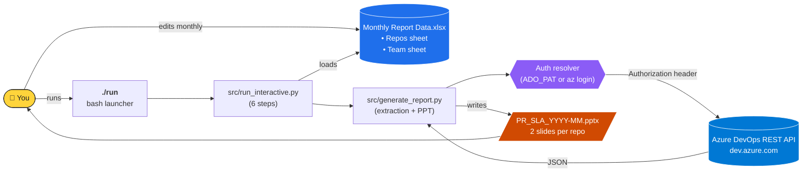
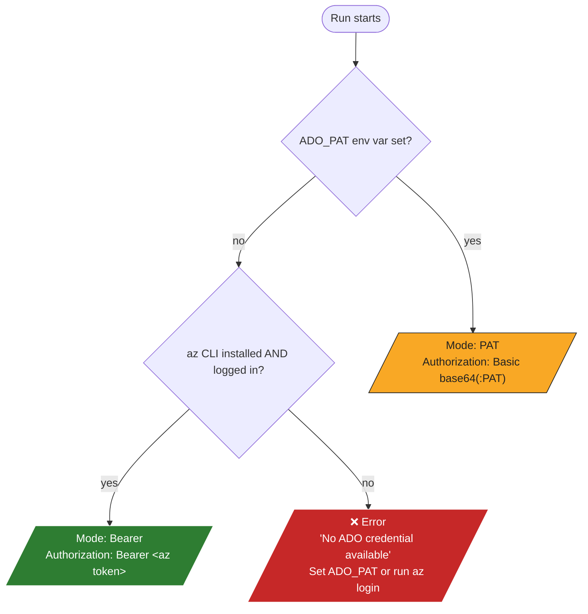
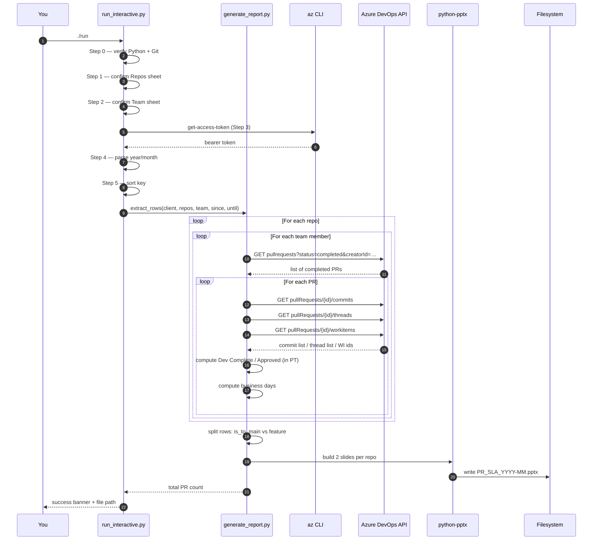
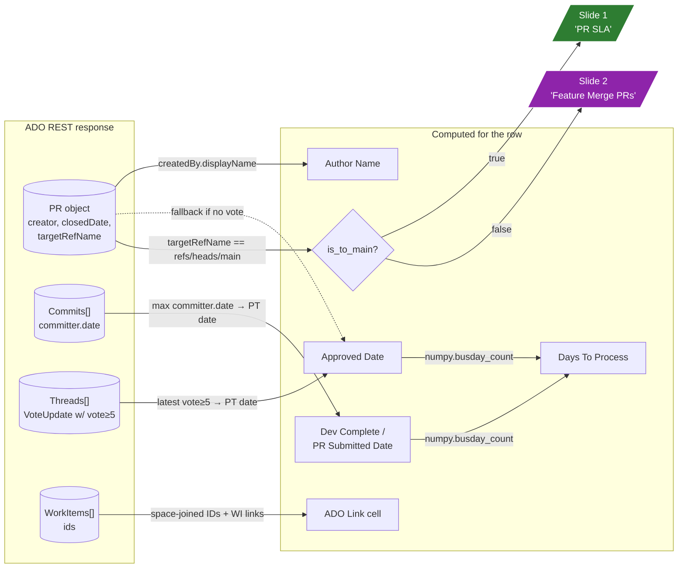

# PR SLA Monthly Report

**Version: 1.4.0** — local-only, no SaaS, no cloud account required (beyond your existing Microsoft corp account).

Auto-generate a PowerPoint deck listing every team member's **completed pull requests** across multiple Azure DevOps repos for a chosen month, with computed SLA metrics (last commit date, last approval date, business days between them) and hyperlinks to every PR and linked work item.

**Two slides per repo:**
1. `<repo> | PR SLA (Month)` — PRs merged to `main`
2. `<repo> | Feature Merge PRs (Month)` — everything else (feature/release branches)

Layout mirrors the `Template` sheet in your Excel config (teal → blue gradient header, 6 columns).

---

## Table of Contents

- [What it does](#what-it-does)
- [Quick Start — Step-by-Step Walkthrough](#quick-start--step-by-step-walkthrough)
- [Architecture & Flow](#architecture--flow)
- [Features](#features)
- [Interactive mode (one command — `./run`)](#interactive-mode-one-command---run)
- [Output columns — full specification](#output-columns--full-specification)
- [Prerequisites — software](#prerequisites--software)
- [First-time setup on any machine](#first-time-setup-on-any-machine)
- [Configuring repos + team (`Monthly Report Data.xlsx`)](#configuring-repos--team-monthly-report-dataxlsx)
- [Personal Access Token (PAT) — required scopes](#personal-access-token-pat--required-scopes)
- [Authentication](#authentication)
- [Running the script locally](#running-the-script-locally)
- [Sorting options](#sorting-options)
- [Automating with GitHub Actions (recommended)](#automating-with-github-actions-recommended)
- [Alternative: macOS launchd (local cron)](#alternative-macos-launchd-local-cron)
- [How each value is computed](#how-each-value-is-computed)
- [Project layout](#project-layout)
- [Troubleshooting](#troubleshooting)
- [Updating the script](#updating-the-script)
- [FAQ](#faq)

---

## What it does

Every month it asks Azure DevOps:

> "For each person on my team, which PRs did they author that were **completed** during this month, in each of these repos?"

For every such PR it pulls:

1. The **last commit** that landed on the PR branch → "Dev Complete / PR Submitted Date".
2. The timestamp of the **last reviewer-approval vote** on the PR → "Approved Date".
3. The IDs of every **linked work item** (ADO tasks/bugs/user stories).
4. The target branch (used to split slides into main-merge vs feature-merge).

Then it computes **business days** between `Dev Complete` and `Approved` (weekends excluded; same-day = `0`), assembles two slides per repo with a hyperlinked table, and writes a `.pptx`.

You run it once a month (or let GitHub Actions run it automatically on the 1st).

---

## Quick Start — Step-by-Step Walkthrough

**Follow these in order.** Steps marked **A. / B. / C.** are one-time setup; steps marked **1. / 2. / 3. …** are what you do each month.

### A. Install prerequisites

| Tool | Why | Install on macOS | Install on Linux | Install on Windows |
|---|---|---|---|---|
| **Python 3.10+** | Runs the script | `brew install python@3.12` | `sudo apt install python3.12 python3.12-venv` | [python.org installer](https://www.python.org/downloads/) — check "Add to PATH" |
| **Git** | Clone the repo | `brew install git` | `sudo apt install git` | [git-scm.com](https://git-scm.com/) |
| **Azure CLI** *(recommended — skip PAT)* | Sign in via browser, no token in dotfiles | `brew install azure-cli` | `curl -sL https://aka.ms/InstallAzureCLIDeb \| sudo bash` | [docs.microsoft.com](https://learn.microsoft.com/cli/azure/install-azure-cli-windows) |

> If you skip Azure CLI you'll have to create a Personal Access Token (PAT) every 90 days. See [Authentication](#authentication) for details.

### B. Get the project and bootstrap

```bash
# Clone (replace URL with wherever you keep it)
git clone <repo-url> ~/Personal/pr-sla-report
cd ~/Personal/pr-sla-report

# Make the launcher executable
chmod +x ./run
```

That's it. The launcher will auto-create a Python `.venv` and install all dependencies the first time you run it. No `pip install` to remember.

### C. Sign in to Azure (one-time, lasts until your refresh token expires)

```bash
az login --tenant 72f988bf-86f1-41af-91ab-2d7cd011db47
```

A browser tab opens for Microsoft sign-in + MFA. After you sign in, your terminal will show a list of Azure subscriptions and ask you to pick a default. **Just press Enter** — the script doesn't use Azure subscriptions, only ADO.

> 🚫 **If you can't or don't want to use Azure CLI**, create a PAT instead: see [Personal Access Token](#personal-access-token-pat--required-scopes), then `export ADO_PAT="<your-token>"` before running.

### D. Edit `Monthly Report Data.xlsx` once

Open it (it's at the repo root). Three sheets:

| Sheet | What to do |
|---|---|
| **Repos** | List every ADO repo URL you want covered, one per row. |
| **Team** | List every team member as `Name, V-id@microsoft.com` (one per row). Only PRs *created by* these people get included. |
| **Template** | Reference only — shows the slide layout. Don't edit. |

Save and close.

---

### 1. Run the tool

```bash
cd ~/Personal/pr-sla-report
./run
```

The launcher will install deps on first run (~30 seconds), then drop you into 6 numbered prompts. Here's exactly what each one looks like and what to pick:

#### Step 0/6 — Prerequisites check

```
[0/6] Mandatory prerequisites
─────────────────────────────────────────────────────────────────────────
  Required on this machine:
    • Python 3.10+  (detected: 3.12.x)  ✓
    • Git           (detected: git version 2.x.x) ✓

  Confirm both Python and Git are installed and you want to continue? [Y/n]:
```

→ Press **Enter** (= Yes). If something's red, install the missing tool from the **A. Install prerequisites** table above.

#### Step 1/6 — Confirm Repos sheet

```
[1/6] Confirm the Repos sheet
─────────────────────────────────────────────────────────────────────────
  Configured in Monthly Report Data.xlsx → sheet Repos:
    1. https://dev.azure.com/MicrosoftIT/OneITVSO/_git/ConsumerStore-WebComponents
    2. https://microsoftit.visualstudio.com/OneITVSO/_git/CE-SITES-aemfnd-MT-AEM

  Are these the correct repos? [Y/n]:
```

→ Press **Enter** to accept. If wrong, type **`n`**, fix the xlsx, re-run.

#### Step 2/6 — Confirm Team sheet

```
[2/6] Confirm the Team sheet
─────────────────────────────────────────────────────────────────────────
  Configured in Monthly Report Data.xlsx → sheet Team:
    Name                          V-id (UPN)
    Akshay Lagad                  v-aklagad@microsoft.com
    Avinash MANDALAPU             v-avinashman@microsoft.com
    ...

  Are all N team members correct and up to date? [Y/n]:
```

→ Press **Enter**. Same exit-and-fix flow if anything is missing.

#### Step 3/6 — Azure DevOps credentials

If `az login` succeeded (step C), you'll see:

```
[3/6] Azure DevOps credentials
─────────────────────────────────────────────────────────────────────────
  Trying Azure CLI for a bearer token...
  ✓ Got a bearer token from `az` (2636 chars).
  No PAT needed. This token is valid for ~1–12 hours.
  Use this token? [Y/n]:
```

→ Press **Enter** to use the `az` token. Done.

If you didn't `az login`, it falls back to asking for a PAT (input hidden, like `sudo` — the script never writes it to disk).

#### Step 4/6 — Reporting period

```
[4/6] Reporting period
─────────────────────────────────────────────────────────────────────────
  Format: YYYY/MM  (e.g. 2026/05 for May 2026)
  Press Enter to accept default (2026/05 = last month).

  Year/Month to report on [2026/05]:
```

→ Press **Enter** for last month, or type `YYYY/MM` (also accepts `2026-05`, `05/2026`).

Future months are rejected.

#### Step 5/6 — Sorting

```
[5/6] Sort the results?
─────────────────────────────────────────────────────────────────────────
  Should the final results be sorted? [Y/n]:
```

→ Press **Enter** (default: sort by Approved Date, ascending).

If you say `y` and continue, you'll be asked to pick a key:

```
  Choose a sort key:
    1) approved      — by Approved Date (default)
    2) dev-complete  — by Dev Complete / PR Submitted Date
    3) days          — by Days To Process (slowest = useful with desc)
    4) author        — alphabetical by team member name

  Pick 1-4 [1]:
```

| Pick | When to use |
|---|---|
| **1 (approved)** *default* | Standard monthly report — chronological by when each PR got approved. |
| **2 (dev-complete)** | When you care about commit-throughput order rather than approval order. |
| **3 (days)** | Highlights bottlenecks. Combine with the descending option below to see slowest PRs first. |
| **4 (author)** | Groups PRs by person — useful for individual contributor reviews. |

```
  Sort descending? (No = ascending) [y/N]:
```

→ Press **Enter** for ascending. Type **`y`** if you picked `days` and want slowest first.

#### Generation phase (no input — runs automatically)

You'll see something like:

```
══════════════════════════════════════════════════════════════════════
Generating report
══════════════════════════════════════════════════════════════════════
  01:52:34 INFO Window: 2026-05-01 → 2026-05-31 (May 2026)
  01:52:34 INFO Reporting timezone: America/Los_Angeles
  01:52:55 INFO == Repo: ConsumerStore-WebComponents (MicrosoftIT) ==
  01:52:58 INFO   Akshay Lagad (v-aklagad@microsoft.com): 4 PR(s)
  01:53:01 INFO   Avinash MANDALAPU (v-avinashman@microsoft.com): 8 PR(s)
  ...
  ─────────────────────────────────────────────────────────────────────
  Extraction summary
    ● ConsumerStore-WebComponents              14 PR(s)
    ● CE-SITES-aemfnd-MT-AEM                   14 PR(s)
  Total: 28 PR(s)
  01:53:08 INFO Slides built: 22 main-merge PR(s), 6 feature-merge PR(s)
  01:53:08 INFO Wrote output/PR_SLA_2026-05.pptx
```

#### Done

```
══════════════════════════════════════════════════════════════════════
✓ Report generated
══════════════════════════════════════════════════════════════════════
  SUCCESS
  File:  /Users/<you>/Personal/pr-sla-report/output/PR_SLA_2026-05.pptx
  Size:  32.0 KB
  Slides: 4  (2 per repo)

  Open with:
    open '/Users/<you>/Personal/pr-sla-report/output/PR_SLA_2026-05.pptx'
```

Copy-paste the `open` line into the terminal to launch the deck in PowerPoint/Keynote.

---

## Architecture & Flow

### High-level component diagram



### Auth resolution waterfall

Each run picks one of two auth modes in this priority order:



> **Recommendation:** use `az login`. PAT mode is kept for GitHub Actions (CI can't sign in interactively).

### End-to-end sequence (what happens when you press Enter on Step 4)



### What each value in the deck comes from



---

## Features

| Feature | Notes |
|---|---|
| **Multi-repo** | Add as many repos as you want — one slide per repo. Supports both `dev.azure.com/<org>/<project>/_git/<repo>` and legacy `<org>.visualstudio.com/<project>/_git/<repo>` URLs. |
| **Per-person filter** | Configurable team list in Excel (Name + UPN). Resolved to ADO identity GUID per org and cached. |
| **Real approval timestamps** | Reads PR threads and picks the latest `VoteUpdate` with vote ≥ 5 (Approved or Approved-with-suggestions). Not just "PR closed date". |
| **Business-day math** | `numpy.busday_count`; weekends excluded; US holidays NOT excluded by default (configurable in code). |
| **Hyperlinked output** | Every ADO work item ID is a click-through link to the work item; the PR URL is a click-through link to the PR. |
| **Multiple ADO IDs per PR** | Rendered space-separated in one cell (matches your existing template). |
| **Configurable sort** | `--sort-by approved` (default), `dev-complete`, `days`, or `author`; `--desc` flips order. |
| **Three date selection modes** | Default: previous calendar month. Or `--month YYYY-MM`. Or custom `--from / --to`. |
| **Throttle-aware** | ADO `429` and `5xx` responses are retried with exponential backoff. |
| **CI-ready** | Included GitHub Actions workflow runs monthly and uploads the deck as an artifact for 90 days. |

---

## Interactive mode (one command — `./run`)

For day-to-day use, you don't need to remember any flags. Just run:

```bash
./run
```

(or `.venv/bin/python src/run_interactive.py` if you prefer)

It walks you through **6 steps** (1 prerequisite check + 5 prompts):

| # | Prompt | What it does |
|---|---|---|
| 0 | **Prerequisites** | Detects your Python version and whether `git` is on PATH. Shows install commands for macOS / Linux / Windows. Asks `y/n` to continue. Refuses to continue if Python is older than 3.10 unless you override. |
| 1 | **Confirm repos** | Displays every repo URL from the `Repos` sheet and asks `y/n`. If `n`, exits so you can fix the Excel file. |
| 2 | **Confirm team** | Displays every team member (Name + V-id) from the `Team` sheet and asks `y/n`. Same exit behavior if `n`. |
| 3 | **PAT** | Shows step-by-step instructions for creating the PAT with the correct scopes, then prompts for the token **with input hidden** (like `sudo`). If `ADO_PAT` is already set in the environment, offers to reuse it. The PAT is held in memory only — never written to disk. |
| 4 | **Year/Month** | Format `YYYY/MM` (e.g. `2026/05`). Accepts `2026-05`, `05/2026`, etc. Press Enter to accept the default (previous calendar month). Future months are rejected. |
| 5 | **Sort?** | `y/n`. If `y`, choose key (1=approved, 2=dev-complete, 3=days, 4=author) and ascending/descending. |

Then it runs, prints a per-repo extraction summary (PR counts), and ends with:

```
══════════════════════════════════════════════════════════════════════
✓ Report generated
══════════════════════════════════════════════════════════════════════
  SUCCESS
  File:  /Users/<you>/Personal/pr-sla-report/output/PR_SLA_2026-05.pptx
  Size:  31.2 KB
  Slides: 2  (one per repo)

  Open with:
    open '/Users/<you>/Personal/pr-sla-report/output/PR_SLA_2026-05.pptx'
```

Ctrl-C at any prompt cancels cleanly.

---

## Output columns — full specification

> **Date conversion:** ADO returns all timestamps in UTC. The dates shown in the deck are converted to **Pacific Time (`America/Los_Angeles`)** before being truncated to a day. Override with `--tz <IANA name>` (e.g. `--tz Asia/Kolkata`).

> **Slide layout (v1.2.0+):** For each repo the deck contains **two slides**:
> 1. **`<repo> | PR SLA (Month)`** — PRs whose target branch is `main`.
> 2. **`<repo> | Feature Merge PRs (Month)`** — every other completed PR (feature branches, release branches, etc.).
>
> Both slides use the same 6-column table. The feature-merge slide is rendered even when empty so the deck always has the same slide count.

| # | Column header (in PPT) | Source | Format | Hyperlink? |
|---|---|---|---|---|
| 1 | **ADO Link** | All work-item IDs linked to the PR via the ADO `pullRequests/{id}/workitems` endpoint. | Space-separated list of numeric IDs (e.g. `15717821  15732018  15706485`). | ✅ Each ID links to `https://dev.azure.com/<org>/<project>/_workitems/edit/<id>`. |
| 2 | **PR** | The PR's canonical web URL. | Plain URL text. | ✅ The whole cell is a link to `https://dev.azure.com/<org>/<project>/_git/<repo>/pullrequest/<id>`. |
| 3 | **Dev Complete / PR Submitted Date** | The **publish date of the latest commit** on the PR source branch (`committer.date`, falling back to `author.date`). | `MM/DD/YYYY` | — |
| 4 | **Approved Date** | The **publish date of the latest reviewer approval vote** on the PR (vote == `10` Approved, or vote == `5` Approved-with-suggestions). | `MM/DD/YYYY` | — |
| 5 | **Days To Process** | `numpy.busday_count(Dev Complete, Approved)` — **weekdays only**; same-day = `0`; never negative. | Integer, centered. | — |
| 6 | **Comments** | Always empty in generated output — reserved for you to type your notes in PowerPoint. | — | — |

Slide title is rendered in red, format: `<repo-name> | PR SLA (<Month YYYY>)`.

---

## Prerequisites — software

You need **two things** on the machine that will generate the deck:

| Tool | Minimum version | Purpose | Install |
|---|---|---|---|
| **Python** | 3.10+ (3.12 recommended) | Runs the script | macOS: `brew install python@3.12` <br> Windows: [python.org installer](https://www.python.org/downloads/) <br> Linux: `apt install python3.12 python3.12-venv` |
| **Git** | any | Clone this repo + version control | macOS: `brew install git` <br> Windows: [git-scm.com](https://git-scm.com/) <br> Linux: `apt install git` |

That's it — every other dependency is pulled from `requirements.txt` into an isolated virtual environment.

**No PowerPoint installation needed.** The `.pptx` file is generated standalone by the `python-pptx` library; open the result in PowerPoint, Keynote, Google Slides, or LibreOffice.

---

## First-time setup on any machine

```bash
# 1. Clone the repo
git clone <your-fork-url> ~/Personal/pr-sla-report
cd ~/Personal/pr-sla-report

# 2. (macOS/Linux) Make the launcher executable
chmod +x ./run

# 3. Run it — it auto-creates the venv and installs deps on first run
./run
```

That's it. You'll be walked through step 0 (prerequisite check) + 5 prompts
(repos / team / PAT / month / sort) and the resulting `.pptx` will be saved to
`output/`.

### Manual / advanced setup

If you'd rather use the lower-level CLI (e.g. for cron, CI, or non-interactive
runs) see [Running the script locally](#running-the-script-locally).

```bash
python3 -m venv .venv
source .venv/bin/activate          # macOS/Linux
# .venv\Scripts\activate           # Windows PowerShell
pip install -r requirements.txt
export ADO_PAT="<paste-your-token>"
python src/generate_report.py      # non-interactive, previous month
```

---

## Configuring repos + team (`Monthly Report Data.xlsx`)

Open [Monthly Report Data.xlsx](Monthly%20Report%20Data.xlsx) at the repo root — it has **three sheets**:

### Sheet 1: `Repos`

One ADO repo URL per row under the header `ADO Repo`. Any of these URL shapes work:

```
https://dev.azure.com/<org>/<project>/_git/<repo>
https://<org>.visualstudio.com/<project>/_git/<repo>
```

Currently configured:
- `MicrosoftIT/OneITVSO/ConsumerStore-WebComponents`
- `microsoftit/OneITVSO/CE-SITES-aemfnd-MT-AEM`

Add or remove rows to change which repos appear as slides.

### Sheet 2: `Team`

Two columns: `Name` (display only) and `V-id` (must be the person's UPN / Microsoft login email, e.g. `v-aklagad@microsoft.com`).

The script resolves each UPN to an ADO identity GUID once per run (and caches it). Only PRs where this identity is the **creator** are included.

### Sheet 3: `Template`

Reference only — shows the target table shape and screenshot the script reproduces. Ignored at runtime; safe to edit or delete.

---

## Personal Access Token (PAT) — required scopes

> **You can skip the PAT entirely if you use `az login`.** See [Authentication](#authentication) below.

Create at **https://dev.azure.com/MicrosoftIT/_usersSettings/tokens** → **+ New Token**.

| Field | Value |
|---|---|
| Name | `pr-sla-report` |
| Organization | **All accessible organizations** (your 2 repos live under both `MicrosoftIT` and `microsoftit`) |
| Expiration | 90 days max (then rotate) |
| Scopes | **Custom defined** — uncheck everything, then check only: |

| Scope group | Permission | Why |
|---|---|---|
| **Code** | Read | List + read completed PRs, their commits, and their threads |
| **Work Items** | Read | Fetch the work-item IDs linked to each PR |
| **Identity** | Read | Resolve each `v-xxx@microsoft.com` UPN to an ADO identity GUID |

Click **Create**. **Copy the token immediately** — ADO never shows it again. If you lose it, regenerate.

---

## Authentication

v1.3.0+ supports two auth modes. The script auto-detects in this order:

| Priority | Mode | When to use | Setup |
|---|---|---|---|
| 1 | **`ADO_PAT` env var** | CI / GitHub Actions, or if you already have a PAT in your shell | `export ADO_PAT=...` |
| 2 | **`az` CLI bearer token** | Local laptop — no secret in dotfiles, browser-based MFA cached for hours | `brew install azure-cli && az login` |
| 3 | (none → error) | — | — |

### Using `az` (recommended for local runs)

```bash
brew install azure-cli
az login --tenant 72f988bf-86f1-41af-91ab-2d7cd011db47   # MicrosoftIT tenant
```

That's it. Next `./run` (or `python src/generate_report.py`) will pick up the token automatically. No PAT in `~/.zshrc`, no 90-day rotation.

The cached `az` token is valid for about an hour but is silently refreshed for you up to ~24 hours (longer if your conditional-access policy permits). When it stops refreshing, you'll be prompted to `az login` again.

### Removing your existing PAT

If you switch to `az`, remove the line `export ADO_PAT=...` from `~/.zshrc` and **rotate the token** at https://dev.azure.com/MicrosoftIT/_usersSettings/tokens so the old value can't be reused.

### GitHub Actions still needs a PAT

GitHub Actions runners can't `az login` interactively. The monthly workflow continues to use the `ADO_PAT` repo secret. Local use can be PAT-free; CI cannot.

---

## Running the script locally

```bash
# Previous calendar month (default)
python src/generate_report.py

# A specific month
python src/generate_report.py --month 2026-05

# Arbitrary date range
python src/generate_report.py --from 2026-04-01 --to 2026-04-30

# Choose a sort
python src/generate_report.py --sort-by dev-complete
python src/generate_report.py --sort-by approved --desc
python src/generate_report.py --sort-by days
python src/generate_report.py --sort-by author

# Choose a timezone (default America/Los_Angeles = PT)
python src/generate_report.py --tz Asia/Kolkata
python src/generate_report.py --tz UTC

# Custom output path
python src/generate_report.py --output /tmp/may.pptx

# Quieter logging
LOG_LEVEL=WARNING python src/generate_report.py

# Help
python src/generate_report.py --help
```

The default output path is `output/PR_SLA_<YYYY-MM>.pptx` (or `<from>_<to>.pptx` for custom ranges).

---

## Sorting options

| `--sort-by` | What gets used as the key |
|---|---|
| `approved` *(default)* | Approved Date → Dev Complete Date → PR ID |
| `dev-complete` | Dev Complete Date → Approved Date → PR ID |
| `days` | Days To Process → Approved Date → PR ID |
| `author` | Author name (case-insensitive) → Dev Complete Date → PR ID |

Add `--desc` to reverse (e.g. show slowest PRs first with `--sort-by days --desc`).

---

## Automating with GitHub Actions (recommended)

The repo ships with [.github/workflows/monthly-report.yml](.github/workflows/monthly-report.yml) which:

- Runs on a cron schedule: **1st of every month at 02:00 UTC** (≈ 7:30 AM IST, 7 PM PT the day before).
- Can also be triggered manually with an optional `YYYY-MM` override.
- Uploads the generated `.pptx` as a workflow **artifact** (retained 90 days).

### One-time setup

```bash
# Push the repo to GitHub (private recommended)
gh repo create pr-sla-report --private --source=. --push
```

Then in the GitHub web UI:

1. **Settings → Secrets and variables → Actions → New repository secret**
   - Name: `ADO_PAT`
   - Value: the PAT you created above
2. **Actions** tab → enable workflows if prompted.

### Each month

You don't have to do anything — the deck is generated automatically and is downloadable from:

> **Actions → Monthly PR SLA Report → latest run → Artifacts → `pr-sla-report`**

To re-run for any past month: **Run workflow → Override month: `2026-05`**.

---

## Alternative: macOS launchd (local cron)

If you'd rather run it on your own laptop instead of GitHub Actions:

```bash
cat > ~/Library/LaunchAgents/com.amandalapu.pr-sla.plist <<'EOF'
<?xml version="1.0" encoding="UTF-8"?>
<!DOCTYPE plist PUBLIC "-//Apple//DTD PLIST 1.0//EN" "http://www.apple.com/DTDs/PropertyList-1.0.dtd">
<plist version="1.0">
<dict>
  <key>Label</key>           <string>com.amandalapu.pr-sla</string>
  <key>ProgramArguments</key>
  <array>
    <string>/bin/zsh</string>
    <string>-c</string>
    <string>cd $HOME/Personal/pr-sla-report && .venv/bin/python src/generate_report.py</string>
  </array>
  <key>EnvironmentVariables</key>
  <dict>
    <key>ADO_PAT</key><string>YOUR_PAT_HERE</string>
  </dict>
  <key>StartCalendarInterval</key>
  <dict>
    <key>Day</key><integer>1</integer>
    <key>Hour</key><integer>8</integer>
    <key>Minute</key><integer>0</integer>
  </dict>
  <key>StandardOutPath</key><string>/tmp/pr-sla.log</string>
  <key>StandardErrorPath</key><string>/tmp/pr-sla.err</string>
</dict>
</plist>
EOF

launchctl load ~/Library/LaunchAgents/com.amandalapu.pr-sla.plist
```

Only runs while your Mac is awake. GitHub Actions doesn't have that limitation.

---

## How each value is computed

### Dev Complete / PR Submitted Date

```
GET /git/repositories/{repo}/pullRequests/{pr_id}/commits
```
Take the commit with the maximum `committer.date` (fall back to `author.date` if missing). Truncate to a date.

### Approved Date

```
GET /git/repositories/{repo}/pullRequests/{pr_id}/threads
```

ADO records each vote change as a *system thread* with `properties.CodeReviewThreadType == "VoteUpdate"`. The vote value is in `properties.CodeReviewVoteResult.$value`:

| Vote value | Meaning |
|---|---|
| `10` | Approved |
| `5` | Approved with suggestions |
| `0` | No vote / reset |
| `-5` | Waiting for author |
| `-10` | Rejected |

We filter to threads with vote `≥ 5`, take the latest `comments[].publishedDate` across all such threads, and truncate to a date. If no approval vote ever happened (e.g. the PR was force-merged by an admin), we fall back to the PR's `closedDate` and log a warning.

### Days To Process

```python
numpy.busday_count(dev_complete_date, approved_date, holidays=MS_HOLIDAYS)
```

- **Weekends are always excluded.**
- **Microsoft-observed holidays are excluded by default (v1.4.0+)**: the script fetches your company's official holiday list from `holidays.microsoft.com` (HR API: `hrdp-api.microsoft.com`) using your `az` bearer token, caches it under `~/.cache/pr-sla-report/holidays-YYYY.json`, and excludes those dates too. For 2026 (US, company code 1010) this is **10 days**: New Year's Day, MLK Day, Presidents Day, Memorial Day, Independence Day (Jul 3 observed), Labor Day, Thanksgiving, Day After Thanksgiving, Christmas Eve, Christmas Day.
- Same-day = `0`.
- Approved before Dev Complete (rare; can happen if someone approved, then more commits came in but no re-approval) → clamped to `0`.
- To disable holiday exclusion entirely, pass `--holidays off`.
- If `az` isn't available (e.g. running in CI with `ADO_PAT` only) the holiday fetch is silently skipped and the report falls back to weekends-only.

---

## Project layout

```
pr-sla-report/
├── .github/
│   └── workflows/
│       └── monthly-report.yml      # cron + manual dispatch
├── output/                         # generated .pptx files (gitignored)
├── src/
│   ├── generate_report.py          # core extraction + PPT build (also a CLI)
│   ├── run_interactive.py          # interactive 6-step wrapper (Step 0 + 5 prompts)
│   └── diag_pr.py                  # per-PR debug helper (`python src/diag_pr.py <id>`)
├── run                             # convenience launcher (auto-creates venv)
├── .gitignore
├── CONTEXT.md                      # design notes for AI agents working on this repo
├── Monthly Report Data.xlsx        # repos + team + template (the only file you edit)
├── README.md                       # this file
└── requirements.txt                # Python deps
```

---

## Troubleshooting

| Symptom | Cause / Fix |
|---|---|
| `ADO_PAT env var is required.` | `export ADO_PAT=<token>` in your shell, or add to `~/.zshrc`. |
| `requests.exceptions.HTTPError: 401 Unauthorized` | PAT expired or wrong scope. Regenerate with Code:Read + Work Items:Read + Identity:Read. |
| `requests.exceptions.HTTPError: 403 Forbidden` | PAT doesn't have access to that specific org/project. Re-issue with "All accessible organizations". |
| `No ADO identity for v-xxx@microsoft.com in <org>` | That UPN can't be resolved in that ADO org. Double-check spelling, or the person doesn't have an account in that org. |
| `No approval vote found, falling back to closedDate` (warning, not an error) | The PR was merged without a recorded reviewer vote (e.g. force-pushed by an admin). The script uses `closedDate` as the best available timestamp. |
| `429 Too Many Requests` in logs but eventually succeeds | Normal — the client retries with backoff. |
| Slide title or table looks off | Open the `.pptx` in PowerPoint (not Quick Look in Finder, which renders fonts differently). |
| GitHub Action fails with secret not found | Add `ADO_PAT` under Settings → Secrets and variables → Actions. |

---

## Updating the script

```bash
cd ~/Personal/pr-sla-report
git pull
.venv/bin/pip install -r requirements.txt   # in case deps changed
```

---

## FAQ

**Q: Can I add more repos?**
Add a row in `Repos` sheet of `Monthly Report Data.xlsx`. Push the change to GitHub — the workflow picks it up next run.

**Q: Can I add more team members?**
Add a row in `Team` sheet with their full name and UPN.

**Q: Does it count PRs where the person was a reviewer?**
No — only PRs where the person is the **creator/author**. To change this, modify the `searchCriteria.creatorId` filter in `completed_prs_for_user()`.

**Q: What if a PR was approved multiple times (e.g. someone reset their vote and re-approved)?**
The script uses the **latest** approve-vote timestamp it finds.

**Q: Why business days instead of calendar days?**
Matches the existing SLA definition in your screenshot — weekends shouldn't count against the team's turnaround.

**Q: Can I include US holidays?**
Yes, easily. Edit `business_days_between` in [src/generate_report.py](src/generate_report.py):

```python
import numpy as np
US_HOLIDAYS_2026 = ['2026-01-01', '2026-01-19', '2026-02-16', '2026-05-25', ...]
return int(np.busday_count(start, end, holidays=US_HOLIDAYS_2026))
```

**Q: Can I get the deck emailed to me?**
Yes — add a step to the GitHub Actions workflow using e.g. [dawidd6/action-send-mail](https://github.com/dawidd6/action-send-mail) or a Teams webhook. Ask and I'll wire it up.
